Sou o **H3nj1**, analista de segurança ofensiva e defensiva. Gosto de entender como um programa funciona por dentro, descobrir onde ele pode falhar e escrever ferramentas que ajudem a investigar o que aconteceu.

## Linguagens

- **Sistemas e aplicações nativas** · Rust, C, C++, Go, C# e Java
- **Desenvolvimento web** · TypeScript, JavaScript, PHP e Ruby
- **Scripts e consultas** · Python, Bash e SQL

## Hacking

| Área | O que faço |
| --- | --- |
| Segurança ofensiva | Mapeio serviços com Nmap e investigo o comportamento de aplicações web com Burp Suite. |
| Engenharia reversa | Examino binários no Ghidra para entender a lógica do programa além do código-fonte. |
| Defesa e investigação | Analiso tráfego no Wireshark e cruzo eventos de segurança para investigar incidentes. |

## Em destaque · Aegis

No **Aegis**, Rust e TypeScript se encontram em uma aplicação de segurança para desktop. Com ela, dá para revisar configurações locais, verificar arquivos com ClamAV e gerenciar o firewall do sistema pela mesma interface.

[Explorar o código do Aegis →](https://github.com/henji-ware/Aegis)
